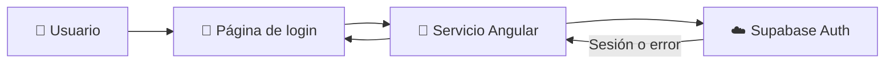
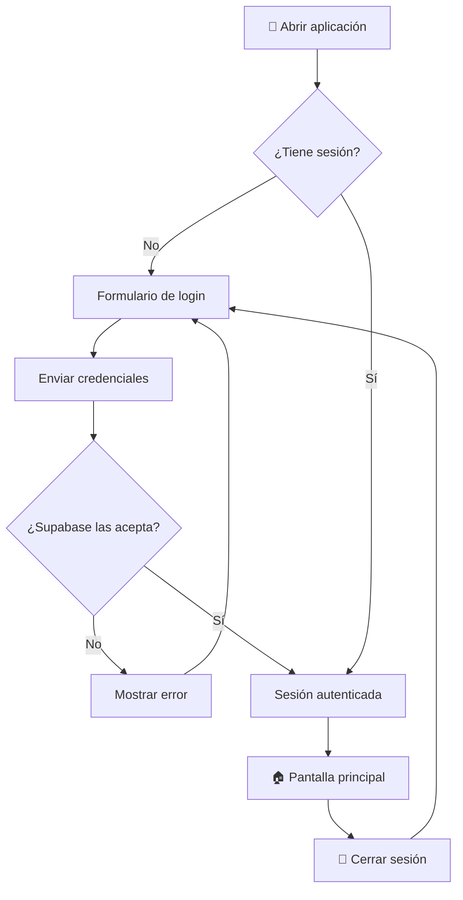

<div align="center">

# 🔐 Login con Ionic, Angular Standalone y Supabase

### Guía práctica de autenticación para Desarrollo de Aplicaciones Móviles

[](https://ionicframework.com/)
[](https://angular.dev/)
[](https://supabase.com/)
[](https://www.typescriptlang.org/)

**Escuela Politécnica Nacional · Desarrollo de Aplicaciones Móviles**

[📂 Ver código](https://github.com/jzaldumbide/loginsupabase/tree/main/src/app) · [📖 Documentación de Supabase](https://supabase.com/docs/guides/auth) · [⚡ Documentación de Ionic](https://ionicframework.com/docs)

</div>

---

> [!NOTE]
> Este README es una **guía didáctica de referencia** para reproducir un login con Ionic Angular Standalone y Supabase. Los fragmentos de código muestran una implementación propuesta: **no se han verificado contra los archivos del repositorio**. Si el proyecto existente tiene otros nombres de páginas, servicios o rutas, adapta los ejemplos.

## 📑 Contenido

- [🎯 Objetivos](#-objetivos)
- [🧰 Tecnologías y requisitos](#-tecnologías-y-requisitos)
- [🏗️ Arquitectura](#️-arquitectura)
- [🚀 1. Clonar y ejecutar](#-1-clonar-y-ejecutar)
- [🆕 2. Crear el proyecto desde cero](#-2-crear-el-proyecto-desde-cero)
- [☁️ 3. Configurar Supabase](#️-3-configurar-supabase)
- [🔌 4. Conectar Angular con Supabase](#-4-conectar-angular-con-supabase)
- [🔑 5. Crear el servicio de autenticación](#-5-crear-el-servicio-de-autenticación)
- [📱 6. Construir la pantalla de login](#-6-construir-la-pantalla-de-login)
- [🧭 7. Configurar las rutas](#-7-configurar-las-rutas)
- [🔄 8. Comprender el flujo de autenticación](#-8-comprender-el-flujo-de-autenticación)
- [🛡️ Seguridad](#️-seguridad)
- [🧪 Pruebas y problemas frecuentes](#-pruebas-y-problemas-frecuentes)
- [📝 Actividad para estudiantes](#-actividad-para-estudiantes)
- [📚 Recursos](#-recursos)

## 🎯 Objetivos

Al terminar esta práctica podrás:

- Crear una aplicación **Ionic + Angular Standalone**.
- Conectar una aplicación móvil con **Supabase Auth**.
- Registrar usuarios con correo electrónico y contraseña.
- Iniciar y cerrar sesión.
- Consultar la sesión y comprender la diferencia entre autenticación y autorización.
- Identificar las precauciones de seguridad necesarias antes de publicar una app.

## 🧰 Tecnologías y requisitos

| Tecnología | Función |
|:--|:--|
| **Ionic** | Componentes visuales para la app móvil |
| **Angular Standalone** | Componentes y navegación sin NgModules |
| **TypeScript** | Lógica de la aplicación |
| **Supabase Auth** | Registro, inicio de sesión y tokens |
| **Capacitor** | Integración opcional con Android/iOS |

**Antes de empezar:** instala Node.js, npm, Git e Ionic CLI; crea una cuenta de Supabase.

```bash
node --version
npm --version
git --version
npm install -g @ionic/cli
ionic --version
```

## 🏗️ Arquitectura



> [!TIP]
> La aplicación **no verifica contraseñas por su cuenta**. Envía las credenciales mediante el SDK de Supabase, que gestiona la autenticación.

## 🚀 1. Clonar y ejecutar

```bash
git clone https://github.com/jzaldumbide/loginsupabase.git
cd loginsupabase
npm install
ionic serve
```

Abre la dirección que muestre la consola (habitualmente `http://localhost:8100`).

> [!IMPORTANT]
> Para que el login funcione, el proyecto debe apuntar a un proyecto Supabase válido. Revisa dónde se configuran la **Project URL** y la **publishable key** en la implementación que descargaste.

<details>
<summary>💡 ¿Qué hace cada comando?</summary>

| Comando | Explicación |
|:--|:--|
| `git clone` | Descarga el repositorio |
| `cd` | Entra en su carpeta |
| `npm install` | Instala dependencias declaradas en `package.json` |
| `ionic serve` | Compila y ejecuta el servidor de desarrollo |

</details>

## 🆕 2. Crear el proyecto desde cero

Si quieres **reconstruir el ejercicio**, en lugar de clonar el repositorio:

```bash
ionic start loginsupabase blank --type=angular-standalone
cd loginsupabase
npm install @supabase/supabase-js
ionic serve
```

**¿Qué significa Standalone?** Cada componente declara sus dependencias en `imports`, sin necesidad de registrarse en un `NgModule`.

```ts
@Component({
  selector: 'app-login',
  standalone: true,
  imports: [FormsModule, IonContent, IonInput, IonButton],
  templateUrl: './login.page.html'
})
export class LoginPage {}
```

## ☁️ 3. Configurar Supabase

1. Entra en el [panel de Supabase](https://supabase.com/dashboard) y crea un proyecto.
2. En **Authentication → Providers → Email**, comprueba que el proveedor Email esté habilitado.
3. Busca la **Project URL** y la **publishable key** en la configuración de API del proyecto.
4. Decide si exigirás **confirmación del correo electrónico** (recomendado).

| Dato | Ejemplo | ¿Puede ir en el cliente? |
|:--|:--|:--:|
| Project URL | `https://ejemplo.supabase.co` | ✅ |
| Publishable key | `sb_publishable_...` | ✅ |
| Secret / service role key | **No mostrar** | ❌ |

> [!CAUTION]
> **Nunca** incluyas claves secretas ni `service_role` en una app Ionic, archivos públicos o repositorios. La publishable key no otorga autorización por sí misma: aplica políticas **Row Level Security (RLS)** a las tablas expuestas.

## 🔌 4. Conectar Angular con Supabase

En un proyecto creado desde cero, configura el archivo `src/environments/environment.ts`:

```ts
export const environment = {
  production: false,
  supabaseUrl: 'https://TU_PROYECTO.supabase.co',
  supabaseKey: 'TU_PUBLISHABLE_KEY'
};
```

> [!NOTE]
> El archivo `environment.ts` se usa aquí como **ejemplo de configuración**. La estructura del repositorio existente puede ser distinta. Revisa también el entorno de producción si vas a compilar una versión distribuible.

Instala el SDK si todavía no está instalado:

```bash
npm install @supabase/supabase-js
```

## 🔑 5. Crear el servicio de autenticación

Genera el servicio:

```bash
ionic generate service services/supabase
```

Implementación de referencia en `src/app/services/supabase.service.ts`:

```ts
import { Injectable } from '@angular/core';
import { createClient, SupabaseClient } from '@supabase/supabase-js';
import { environment } from '../../environments/environment';

@Injectable({ providedIn: 'root' })
export class SupabaseService {
  private readonly client: SupabaseClient = createClient(
    environment.supabaseUrl,
    environment.supabaseKey
  );

  registrar(email: string, password: string) {
    return this.client.auth.signUp({ email, password });
  }

  iniciarSesion(email: string, password: string) {
    return this.client.auth.signInWithPassword({ email, password });
  }

  obtenerUsuario() {
    return this.client.auth.getUser();
  }

  obtenerSesion() {
    return this.client.auth.getSession();
  }

  cerrarSesion() {
    return this.client.auth.signOut();
  }
}
```

### 🧠 ¿Qué hace cada método?

| Método | Resultado |
|:--|:--|
| `signUp()` | Solicita el registro de un usuario |
| `signInWithPassword()` | Valida credenciales e inicia sesión |
| `getUser()` | Consulta el usuario autenticado mediante Supabase Auth |
| `getSession()` | Recupera la sesión disponible en el cliente |
| `signOut()` | Cierra la sesión |

> [!IMPORTANT]
> `getSession()` sirve para gestionar la experiencia de usuario, pero **no sustituye la verificación de identidad y permisos del lado del servidor**.

## 📱 6. Construir la pantalla de login

Genera una página standalone:

```bash
ionic generate page pages/login
```

### `src/app/pages/login/login.page.ts`

```ts
import { Component } from '@angular/core';
import { FormsModule } from '@angular/forms';
import { Router } from '@angular/router';
import {
  IonButton, IonContent, IonInput, IonItem
} from '@ionic/angular/standalone';
import { SupabaseService } from '../../services/supabase.service';

@Component({
  selector: 'app-login',
  standalone: true,
  imports: [FormsModule, IonButton, IonContent, IonInput, IonItem],
  templateUrl: './login.page.html'
})
export class LoginPage {
  email = '';
  password = '';
  mensaje = '';
  cargando = false;

  constructor(
    private readonly auth: SupabaseService,
    private readonly router: Router
  ) {}

  async ingresar() {
    this.mensaje = '';
    this.cargando = true;
    try {
      const { error } = await this.auth.iniciarSesion(
        this.email.trim(), this.password
      );
      if (error) {
        this.mensaje = 'No se pudo iniciar sesión. Revisa tus credenciales.';
        return;
      }
      await this.router.navigateByUrl('/home', { replaceUrl: true });
    } catch {
      this.mensaje = 'No se pudo conectar con el servicio.';
    } finally {
      this.cargando = false;
    }
  }

  async registrar() {
    this.mensaje = '';
    this.cargando = true;
    try {
      const { error } = await this.auth.registrar(
        this.email.trim(), this.password
      );
      this.mensaje = error
        ? 'No se pudo completar el registro. Verifica los datos.'
        : 'Registro procesado. Revisa tu correo si se requiere confirmación.';
    } catch {
      this.mensaje = 'No se pudo conectar con el servicio.';
    } finally {
      this.cargando = false;
    }
  }
}
```

### `src/app/pages/login/login.page.html`

```html
<ion-content class="ion-padding">
  <div style="max-width: 440px; margin: 15vh auto 0;">
    <h1>🔐 Bienvenido</h1>
    <p>Inicia sesión o crea una cuenta</p>

    <ion-item>
      <ion-input
        label="Correo electrónico"
        labelPlacement="stacked"
        type="email"
        autocomplete="email"
        [(ngModel)]="email">
      </ion-input>
    </ion-item>

    <ion-item>
      <ion-input
        label="Contraseña"
        labelPlacement="stacked"
        type="password"
        autocomplete="current-password"
        [(ngModel)]="password">
      </ion-input>
    </ion-item>

    <ion-button expand="block" [disabled]="cargando || !email || !password"
                (click)="ingresar()">
      Iniciar sesión
    </ion-button>

    <ion-button expand="block" fill="outline"
                [disabled]="cargando || !email || !password"
                (click)="registrar()">
      Crear cuenta
    </ion-button>

    <p role="status" aria-live="polite">{{ mensaje }}</p>
  </div>
</ion-content>
```

> [!TIP]
> `[(ngModel)]` sincroniza los campos con las propiedades del componente. Para aplicaciones reales, añade validación de correo, longitud mínima de contraseña, indicadores de carga y mensajes de error accesibles.

## 🧭 7. Configurar las rutas

En `src/app/app.routes.ts`, incorpora la ruta de login **sin eliminar las rutas que ya tenga tu proyecto**:

```ts
{
  path: 'login',
  loadComponent: () =>
    import('./pages/login/login.page').then(m => m.LoginPage)
}
```

Para abrir la página de login directamente, puedes navegar a `/login`.

> [!WARNING]
> La navegación a `/home` del ejemplo presupone que esa ruta existe. **Navegar a una página no la protege**. Para una pantalla privada debes agregar un guard que compruebe el estado de autenticación; la seguridad de los datos debe imponerse también con RLS en Supabase.

## 🔄 8. Comprender el flujo de autenticación



<details>
<summary>🔍 Autenticación vs. autorización</summary>

- **Autenticación:** ¿quién eres? Ejemplo: iniciar sesión con correo y contraseña.
- **Autorización:** ¿qué puedes hacer? Ejemplo: leer únicamente tus propios registros.
- **JWT:** token firmado que representa información asociada a la sesión.
- **RLS:** políticas de PostgreSQL que restringen las filas accesibles a cada usuario.

</details>

## 🛡️ Seguridad

- [ ] No almacenar contraseñas en tablas propias ni en `localStorage`.
- [ ] No usar claves secretas de Supabase en el cliente.
- [ ] Mantener habilitada la confirmación de correo cuando corresponda.
- [ ] Aplicar RLS a las tablas que contienen datos de usuarios.
- [ ] Proteger rutas para mejorar la experiencia de navegación.
- [ ] Validar autorización en el backend, no solo en Angular.
- [ ] Configurar correctamente las URL de redirección para autenticación por correo.
- [ ] Evitar mostrar tokens o credenciales en registros de producción.

> [!CAUTION]
> Este ejemplo es **educativo**. Antes de desplegar en producción, revisa recuperación de contraseña, gestión de errores, políticas RLS, protección de rutas y persistencia segura de sesiones en dispositivos móviles.

## 🧪 Pruebas y problemas frecuentes

| Situación | Qué revisar |
|:--|:--|
| No inicia sesión | Correo, contraseña y confirmación de email |
| `Invalid login credentials` | Credenciales o existencia del usuario |
| Error de conexión | URL de Supabase y acceso a internet |
| No aparece la página | Ruta registrada en `app.routes.ts` |
| Error con `ngModel` | Importación de `FormsModule` |
| Error de componente Ionic | Importación del componente desde `@ionic/angular/standalone` |
| Registro correcto pero sin sesión | Confirmación de correo habilitada |
| Acceso denegado a datos | Políticas RLS y permisos |

### Lista rápida de comprobación

```text
[ ] La aplicación inicia con ionic serve
[ ] Se muestra el formulario
[ ] Puedo registrar un usuario
[ ] Recibo el correo de confirmación, si está habilitado
[ ] Puedo iniciar sesión
[ ] Los errores se muestran correctamente
[ ] Puedo cerrar sesión
```

## 📝 Actividad para estudiantes

**Reto:** extender el ejemplo de autenticación con una experiencia de usuario más completa.

| Fase | Actividad | Evidencia |
|:--|:--|:--|
| 1 | Crear formulario de registro con confirmación de contraseña | Captura y código |
| 2 | Validar campos y mostrar errores | Pruebas de validación |
| 3 | Mostrar el correo del usuario autenticado | Pantalla de perfil |
| 4 | Implementar cierre de sesión | Demostración |
| 5 | Proteger una ruta con un guard | Prueba de acceso sin sesión |
| 6 | Explicar el manejo de la sesión | Respuestas en el README |

**Preguntas de reflexión:**

1. ¿En qué se diferencian `getUser()` y `getSession()`?
2. ¿Qué ocurre si la confirmación de correo está activada?
3. ¿Por qué una clave publicable no equivale a una clave secreta?
4. ¿Por qué un guard de Angular no reemplaza las políticas RLS?
5. ¿Qué ventajas tiene usar un servicio Angular para centralizar la autenticación?

<details>
<summary>📦 Entregables sugeridos</summary>

- Repositorio con el código fuente.
- Capturas de registro, login y pantalla autenticada.
- Breve explicación de la arquitectura.
- Respuestas a las cinco preguntas.
- Demostración funcional en clase.

</details>

## 📚 Recursos

- [Documentación oficial de Ionic](https://ionicframework.com/docs)
- [Angular: componentes standalone](https://angular.dev/guide/components)
- [Supabase Auth](https://supabase.com/docs/guides/auth)
- [Supabase JavaScript: autenticación](https://supabase.com/docs/reference/javascript/auth-signinwithpassword)
- [Supabase Row Level Security](https://supabase.com/docs/guides/database/postgres/row-level-security)
- [GitHub: diagramas Mermaid](https://docs.github.com/en/get-started/writing-on-github/working-with-advanced-formatting/creating-diagrams)

---

<div align="center">

**👨‍🏫 Juan Pablo Zaldumbide**  
Escuela Politécnica Nacional · Desarrollo de Aplicaciones Móviles

⭐ Si este material te resulta útil, puedes marcar el repositorio con una estrella.

</div>
